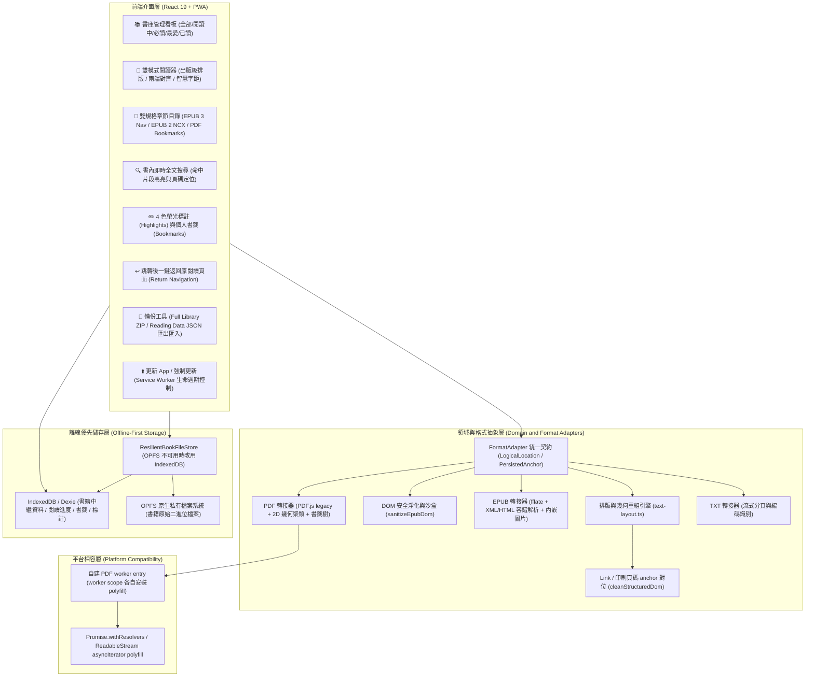

# 墨頁（Codex Book Reader）跨裝置電子書閱讀器：實作總結與踩坑紀錄 (Wrap-up & Pitfalls)

> **專案委託與架構指導**：朱國大醫師 (Kwo-Ta Chu, MD, PhD)
> **系統版本**：v1.1.0 (Production Release，含 iOS Safari 相容性修復)
> **雲端正式網址**：[https://codex-book-reader.web.app](https://codex-book-reader.web.app)
> **技術棧**：React 19 + TypeScript + Vite + Dexie (IndexedDB) + OPFS + PDF.js + fflate + DOMPurify + Semantic CSS + Playwright + Firebase Hosting
> **文件更新日期**：2026-08-30

---

## 1. 產品總覽與核心交付 (Product Overview & Deliverables)

**「墨頁（Codex Book Reader）」** 是一套專為 iPhone 12 Pro Max、iPad（直向與橫向模式）以及桌面瀏覽器量身打造的**現代化、隱私優先、完全離線可用（Offline-First PWA）跨格式電子書閱讀器**。

系統以嚴格的領域驅動設計（DDD）與不可篡改的資料防線為基礎，支援 **EPUB 2 / EPUB 3、PDF（含文字層解析與掃描版降級）以及 TXT** 三大格式，並具備完整之書庫管理、章節目錄跳轉、出版級版面重組、全文檢索、標註書籤與全庫資料備份還原能力。



---

## 2. 核心功能矩陣 (Feature Matrix)

| 功能模組 | 實作細節與技術亮點 |
| :--- | :--- |
| **跨裝置響應式與 PWA** | 專為 iPhone 12 Pro Max（觸控手勢翻頁、底部防誤觸）與 iPad（雙欄書庫、側邊面板展開）最佳化，支援加入主畫面（Standalone）、Service Worker 離線快取與一鍵熱更新。 |
| **多維度書庫管理** | 支援「全部、閱讀中、必讀、最愛、已讀」5 種分類；支援即時 title／author／檔名過濾。 |
| **雙規格 EPUB 支援** | 完整支援 EPUB 3 (`nav.xhtml`) 與 EPUB 2 (`toc.ncx`)，精確提取多層級目錄與章節位移；內建 XML/HTML 雙模容錯解析。 |
| **EPUB 內嵌圖片（Figure）** | 抽取階段為封裝內圖片產生 image token，Render Surface 換成 ``（blob URL，必要時退回 data URL）；只讀封裝內 PNG／JPEG／GIF／WebP／AVIF／SVG，remote 與 `data:` src 一律拒絕。 |
| **書中 Contents 頁可點擊** | 文字抽取同時保留 `<a href>` 與 id anchor 的 offset，清理文字時同步對位；Render Surface 產生 `a.reader-link`，點擊經 `onInternalLink` 導覽。 |
| **目錄頁碼** | EPUB 優先採用書中自帶的印刷頁碼 anchor（`id="pvii"`、`id="p23"`），無 anchor 才回退為目前排版下的 Rendered Page 序號；PDF 使用實際頁次。 |
| **PDF 深度解析與 TOC** | 透過 PDF.js 遞迴提取 PDF Document Outline 書籤樹與目標頁碼；若無書籤則自動啟動「跨頁頂部標題智慧辨識」。 |
| **雙模式 Render Surface** | PDF 由 PDF.js canvas 保留原頁幾何與圖形，另疊 selectable Text Layer；EPUB／TXT 使用安全結構化文字，提供 Serif／Sans、14–32px 字級與 1.4–2.0 行距。 |
| **一鍵返回原頁面** | 從目錄、搜尋、書籤或標註跳轉時自動記憶前次位置並跳出懸浮按鈕 `↩ 返回跳轉前頁面`。 |
| **全文檢索與跳轉** | 無依賴本機即時全文索引，呈現前瞻後顧上下文摘要，點擊搜尋結果瞬間定位。 |
| **標註與個人書籤** | 4 種語意色彩標註（黃、綠、藍、粉）與書籤管理，支援快速跳轉與刪除。 |
| **隱私最小化外連** | 選取文字可一鍵發起 Web Search 或 Google AI Mode，僅外送選取詞彙，絕不洩漏書庫內容。 |
| **全庫資料備份還原** | JSON（純閱讀資料）與 ZIP（含原始書檔）雙向匯出／還原；內建 SHA-256 重複檢驗與衝突解決。 |
| **韌性儲存** | `ResilientBookFileStore`：OPFS 寫入失敗自動改用 IndexedDB，讀取涵蓋兩邊；QuotaExceeded 照實回報，不默默換儲存區。 |
| **更新控制** | 標題列固定顯示「更新 App」；「檢查更新」直接啟用等待中的 Service Worker 並自動重新載入；「強制更新」清除 SW 與 App 快取後重載，不影響書庫資料。 |

---

## 3. 開發過程關鍵踩坑紀錄與工程突破 (Pitfalls & Engineering Solutions)

### 3.1 架構與格式解析

#### 踩坑 1：本機 `file:///` 協定跨來源隔離與 Vite 建置特性
- **問題現象**：直接雙擊 `index.html` 開啟時，畫面全黑或全白，主控台報 `CORS request not supported for file:// URLs`。
- **原因剖析**：React 19 / ES Module 與 PWA Service Worker 依賴 HTTP/HTTPS 的安全上下文（secure context），受同源政策限制無法以 `file://` 載入模組。
- **架構解法**：建立 Firebase Hosting 部署設定（`firebase.json`、`.firebaserc`），設定 SPA rewrite；`sw.js` 與 `manifest.webmanifest` 採 `no-cache`、`/assets/**` 採 `immutable`；正式部署至 HTTPS 網址後才能一鍵加入 iOS 主畫面。

#### 踩坑 2：PDF 文字重排會破壞原始頁面幾何與圖形
- **問題現象**：把 PDF.js 的 `TextItem` 重組成 HTML 段落後，出現巨大詞距、原頁圖形消失，選取後的 anchor 與畫面 DOM 不一致。
- **原因剖析**：PDF 是 fixed-layout。抽取文字適合搜尋與 outline fallback，不適合當可見頁面的唯一來源；否則 canvas、selection 與 persisted anchor 會形成三套座標系。
- **架構解法**：依 ADR 0016 讓 `FormatAdapter` 擁有 Book Render Surface。PDF 以 canvas 呈現原頁 + 同 viewport 的 selectable Text Layer 與 Highlight overlay；EPUB／TXT 的 selection token 直接由實際 Render Surface DOM 計算 exact offset，不用 `indexOf(selection.toString())`（重複文字會誤定位）。

#### 踩坑 3：EPUB 安全過濾之粗暴正則導致真實技術文檔全面拒絕
- **問題現象**：開啟技術類 EPUB 時跳出 `EPUB 含有不允許的 active 或 remote content：python.html`。
- **原因剖析**：舊版用靜態正則 `/<(?:script|form|button)\b/`、`/src=["']https?:/` 硬性阻斷。技術書內文常含 `<form>`、`<button>` 範例程式碼與遠端徽章圖示，直接誤殺。
- **架構解法**：依 ADR 0012 改為 **DOM 級淨化（`sanitizeEpubDom`）**：移除 `<script>`／`<iframe>` 等 active 節點、剝除 `on*` 事件屬性與 `javascript:` 協定、剝除 remote `src`。同時導入 XML/HTML 雙模容錯解析，非嚴格閉合的 XHTML 自動降級為 HTML5 解析樹。

#### 踩坑 4：PDF 目錄缺漏與跨章節跳轉後迷航
- **問題現象**：側邊目錄只有「第 1 頁、第 2 頁…」，且跳轉後回不去原位置。
- **架構解法**：遞迴解析 `getOutline()` 書籤樹，透過 `getDestination()` 與 `getPageIndex()` 定位頁碼；無書籤時啟動標題智慧辨識。`ReaderScreen` 實作 `returnLocation` 狀態機，跳轉時記錄來源並顯示懸浮返回鍵。

#### 踩坑 5：iOS / WebKit Safe Area 與手勢分流
- **架構解法**：所有固定工具列與面板採 `env(safe-area-inset-*)`；左右滑動翻頁門檻 60px，與長按選取手勢精確分流。

---

### 3.2 iOS Safari 實機相容性（本階段最大的坑）

> **共同教訓**：**Playwright WebKit 不等於真實 iOS Safari。** Playwright 的 WebKit 建置具備許多 iOS Safari 沒有的能力，因此以下四個致命錯誤全部通過了自動化測試，卻在實機一開啟就爆炸。真正的錯誤訊息（使用者截圖那一行紅字）才是最有價值的線索。

#### 踩坑 6：`accept` 屬性讓 iOS 檔案選擇器把雲端檔案變灰
- **問題現象**：iPhone／iPad 上，從 Google Drive、Dropbox 選書時檔案呈灰色、點不下去。
- **原因剖析**：iOS Files 面板依 `accept` 的 **UTI** 過濾檔案。第三方 File Provider（Google Drive／Dropbox）提供的 `.epub` 常被判為未知 UTI 而不可選。
- **架構解法**：移除書籍匯入與 Backup 還原兩個 `<input type="file">` 的 `accept`；格式改由 `detectFormat` 以副檔名／MIME 驗證，不支援時明確回報「只支援 EPUB、TXT、PDF。」。
- **延伸教訓**：**這個修復是必要的，但不是使用者問題的根因。** 選擇器能瀏覽之後，匯入仍然全部失敗——真正的原因是下一個坑。診斷不能停在「症狀消失一半」。

#### 踩坑 7：OPFS 在 iOS Safari 17.4 以前沒有 `createWritable()`
- **問題現象**：實機錯誤訊息
  `(await n.getFileHandle(e,{create:!0})).createWritable is not a function`
  → 匯入 100% 失敗，且不分來源（雲端或本機皆然）。
- **原因剖析**：iOS Safari 自 15.2 起就有 OPFS 的目錄／檔案 handle API，但 **`FileSystemFileHandle.createWritable()` 要到 17.4 才有**（更早版本只有 Worker 限定的 `createSyncAccessHandle()`）。因此能力偵測若只檢查 `navigator.storage.getDirectory` 會誤判為「支援」，一路到實際寫入才炸。
- **架構解法**：新增 `ResilientBookFileStore`：
  - 先寫 OPFS；失敗即標記主要儲存區不可用並改用 `IndexedDbBookFileStore`（以 **ArrayBuffer** 保存，部分 Safari 版本對 IndexedDB 中的 Blob 支援不穩）。
  - 讀取／刪除同時涵蓋兩邊，讓不同版本匯入的書都能開啟。
  - `QuotaExceededError` 照實往上拋，**不得**默默換到另一個一樣會滿的儲存區。
  - 寫入失敗前可能已建立空檔，回退時一併清除。
- **教訓**：**能力偵測要偵測「你真正要呼叫的那個方法」**，不是它的父物件。

#### 踩坑 8：PDF.js 6 的 modern build 需要 Safari 尚未提供的引擎能力
本坑分三次才完全解決，三個錯誤訊息各指向不同缺口：

| 實機錯誤訊息 | 缺失能力 | 說明 |
| :--- | :--- | :--- |
| `undefined is not a function`（開啟 PDF 時） | `Promise.withResolvers` | iOS Safari 17.4+ 才有 |
| `undefined is not a function (near '...e of t...')` | `ReadableStream.prototype[Symbol.asyncIterator]` | PDF.js `getTextContent()` 用 `for await (const value of readableStream)`；**Safari 至今未實作** |
| `Can't find variable: Iterator` | Iterator helpers | Safari 18.4+ 才有 |

- **架構解法**：
  1. 改用 **`pdfjs-dist/legacy/build`**（官方為舊環境提供、內含 core-js polyfill 的建置，`Iterator.prototype.drop/filter/flatMap` 等都在裡面）。
  2. `ReadableStream` 的 async iteration 屬 Web API，core-js 不涵蓋，因此**自行撰寫 polyfill**（以 `getReader()` 實作 `next`／`return`，提早 break 時 cancel 並 `releaseLock`）。
  3. **Worker 有獨立的 global scope**：主執行緒安裝 polyfill 對 worker 無效。改為自建 worker entry `src/formats/pdf/pdf-worker.ts`，先 import polyfill 再 import PDF.js worker，並在 `vite.config.ts` 設 `worker: { format: "es" }`（否則 Vite 以 iife 輸出，top-level await 會失敗）。
- **教訓**：`near '...e of t...'` 這種 JavaScriptCore 的來源片段提示極度有用——直接在打包後的 chunk 裡 grep `for await(let e of t)` 就能定位到 `getTextContent()`。

#### 踩坑 9：Service Worker 更新在 iOS 上的實務問題
- **問題現象**：使用者回報「找不到更新按鈕」、修好的版本一直沒生效。
- **原因剖析**：
  1. 「檢查更新」原本藏在**可橫向捲動**的備份工具列裡，在 iPhone 上根本看不到。
  2. 該按鈕只呼叫 `registration.update()`，即使新版已下載完成、處於 `waiting` 狀態也不會套用。
- **架構解法**：標題列固定顯示「更新 App」；檢查更新時若有 `registration.waiting` 則 `postMessage({type:"SKIP_WAITING"})` 並在 `controllerchange` 後自動 reload；另提供「強制更新」（unregister 所有 SW ＋ 清除 Cache Storage ＋ reload），且明確說明**不會刪除書庫的書檔與閱讀資料**。
- **附帶**：實機出現「此環境不支援 Service Worker」通常代表使用者在 **Safari 私密瀏覽視窗**——該模式停用 SW，離線與更新都不會運作。訊息已改為直接說明此事。

---

### 3.3 閱讀體驗與版面

#### 踩坑 10：EPUB 內嵌圖片在文字抽取階段被整個丟棄
- **問題現象**：EPUB 的 Figure 完全不顯示（PDF 走 canvas 所以不受影響）。
- **原因剖析**：EPUB 先前把整本書攤平成一條純文字串流，`` 沒有文字內容，於是被丟掉。
- **架構解法**：抽取時為封裝內圖片產生 **image token**，Render Surface 再換成 ``。關鍵設計：
  - token 使用 **Private Use Area 的單一 code unit**（`\uE000 + index`）——單一 UTF-16 code unit 保證**分頁切片永遠不會把 token 切半**。
  - token 字元本身以 visually hidden 的節點保留在 DOM 中，使 Render Surface 的 `textContent` 長度與來源文字**完全一致**，Highlight 與 Bookmark 的 offset 因此不會位移（此不變式已寫成測試斷言）。

#### 踩坑 11：暗色模式下透明背景插圖等於看不見
- **問題現象**：書中的 callout 方塊呈現「深底深字」，完全無法閱讀。
- **原因剖析**：那些 callout 其實是**透明背景、黑色文字的圖檔**；插圖底色原本設為 `rgba(255,255,255,.08)`，在暗色頁面上幾乎等於透明。
- **架構解法**：`.reader-figure-image` 改為不透明淺色底並加內距，暗色模式另給 `#f6f1e8`。線稿、表格、callout 都比照印刷頁的白底處理。

#### 踩坑 12：目錄沒有頁碼、書中 Contents 頁不能點
- **原因剖析**：
  1. 目錄項目只有標題。Reflowable Book 沒有固定頁數，硬編頁碼並不誠實；但**很多 EPUB 其實內建印刷頁碼 anchor**（calibre 轉檔常保留 `id="pvii"`、`id="p23"`），實測某本書就有 169 個，我們卻沒讀。
  2. 書中 Contents 頁的 `<a href="Ch01.xhtml#Ch01">` 在文字抽取時被丟棄（實測某本書有 2064 個內部連結）。
- **架構解法**：
  - 抽取函式改為回傳 `{ text, marks }`，marks 記錄 link 範圍與 id anchor 位置。
  - **難點**：`cleanStructuredText()` 會 trim 每行、壓縮連續換行，導致所有 offset 位移。因此新增 `cleanStructuredDom()`：以「字元保留決策表」計算來源索引 → 清理後索引的映射，讓 mark 與文字同步對位，並保證輸出文字與原函式**逐字元相同**。
  - 頁碼優先採用印刷頁碼 anchor（`第 vii 頁`），無 anchor 才回退 Rendered Page 序號；封面等第一個 anchor 之前的位置維持空白，不亂編（符合 ADR 0008 來源忠實原則）。

---

### 3.4 驗證方法論的坑（最容易被忽略的一類）

#### 踩坑 13：E2E 測到的是舊 bundle
- **問題現象**：修好 EPUB 圖片後跑 Playwright，4 個 EPUB case 全數失敗。
- **原因剖析**：`playwright.config.ts` 的 `webServer` 是 `vite preview`，**服務的是 `dist`**。改完 source 沒有重新 build，測到的是舊 bundle。
- **紀律**：**改完 source 必須先 `npm run build` 再 `npm run test:e2e`**（已寫入 `handoff.md` 環境注意事項）。

#### 踩坑 14：自動化測試通過 ≠ 實機可用
- 前述四個 iOS 致命錯誤全部通過了 25 項 Playwright E2E。
- **改進做法**：新增「引擎能力缺失模擬」測試——以 `page.addInitScript()` 在載入前刪除 `globalThis.Iterator` 與 `ReadableStream.prototype[Symbol.asyncIterator]`，再匯入並開啟 PDF。
- **關鍵**：這個測試**先驗證過它會 red**（把 import 改回 modern build 重新打包後確實失敗），才算是有效的回歸保護。**沒有驗證過會失敗的測試，不是測試。**

#### 踩坑 15：部署核對只看首頁是不夠的
- **問題現象**：只驗證 `index.html` 相同，無法保證使用者拿到的是完整新版。
- **架構解法**：新增 `npm run verify:deploy`（`scripts/verify-deploy.mjs`），自動列舉 `dist` 下**全部**檔案並逐一比對本機與 production 的 SHA-256（main bundle、PDF chunk、PDF worker、CSS、`sw.js`、workbox runtime、manifest、icon、index.html），不一致即非零離開。
- **附帶發現**：SPA rewrite 會讓不存在的檔案回傳 `index.html` 且 HTTP 200，所以「抓得到內容」不等於「檔案存在」——必須比對雜湊。
- **另一個坑**：PWA `globPatterns` 原本沒有 `.mjs`，PDF worker 不在 precache 內，離線時 PDF 開不了；已補上。

---

## 4. 品質保證與驗證基準 (Testing & Quality Rubric)

專案遵循 TDD；截至 2026-08-30 的自動化驗證如下，實機 Safari 仍是獨立 gate：

```
======================================================================
  Test Suite                        Passed / Total     Status
======================================================================
  Vitest Unit/Integration/Security      60 / 60         PASS (13 files)
  Playwright E2E Matrix                 29 passed       PASS (4 projects)
  Playwright WebKit Offline              3 skipped      ENGINE LIMIT
  TypeScript Typecheck                   0 Errors       PASS (Strict Mode)
  Production Vite Build                  0 Errors       PASS (PWA Bundle)
  Live Deployment SHA-256                10 / 10        PASS (全檔一致)
======================================================================
```

### 跨裝置 E2E 測試驗證矩陣
- **iPhone 12 Pro Max** (428×926, Playwright WebKit, Touch)
- **iPad Portrait** (810×1080, Playwright WebKit, Touch)
- **iPad Landscape** (1080×810, Playwright WebKit, Touch)
- **Desktop Chromium** (1280×800)

### 已知限制（誠實揭露）
1. Playwright WebKit **不等同**實機 Safari；OPFS 由測試專用 storage boundary double 取代，offline reload 因 engine internal error 跳過並由 Chromium 補驗。
2. iPhone／iPad Safari standalone 的原生 OPFS、飛航模式重啟、Dynamic Type、長時間儲存尚未完成完整實機 gate（見 `docs/testing/real-device-safari-checklist.md`）。
3. 字型／行高／PDF zoom 尚未持久化至 Reading Data Backup（storage schema 決策，未確認 migration 與 conflict semantics 前不動）。
4. EPUB 保證安全結構化文字、Highlight、內嵌圖片與 book 內部連結；**不保證**原始 CSS、table fidelity 或 external link interaction。

---

## 5. 專案產出與儲存庫索引 (Products & Artifacts Index)

### 5.1 線上正式站點
- **PWA Web App**：[https://codex-book-reader.web.app](https://codex-book-reader.web.app)

### 5.2 核心原始碼結構
| 路徑 | 職責 |
| :--- | :--- |
| `src/formats/types.ts` | `FormatAdapter` / `ReaderSession` / `LogicalLocation` / `PersistedAnchor` 契約 |
| `src/formats/text-layout.ts` | 結構化文字抽取、image token、link／anchor marks、offset 對位清理 |
| `src/formats/text-render-surface.ts` | EPUB／TXT Render Surface：Highlight、圖片、內部連結與 selection token |
| `src/formats/epub/epub-adapter.ts` | EPUB 2/3 解壓、DOM 淨化、雙規格目錄、內嵌圖片、印刷頁碼與內部連結 |
| `src/formats/pdf/pdf-adapter.ts` | PDF.js legacy build、canvas、Text Layer、Highlight overlay、書籤目錄 |
| `src/formats/pdf/pdf-worker.ts` | 自建 PDF worker entry（先安裝 polyfill 再載入 PDF.js worker） |
| `src/platform/promise-with-resolvers.ts` | `Promise.withResolvers` polyfill |
| `src/platform/readable-stream-async-iterator.ts` | `ReadableStream` async iteration polyfill |
| `src/storage/resilient-book-file-store.ts` | OPFS → IndexedDB 韌性儲存策略 |
| `src/storage/indexeddb-book-file-store.ts` | IndexedDB 書檔儲存（ArrayBuffer） |
| `src/reader/ReaderScreen.tsx` | 閱讀器主畫面、外觀設定、跳轉與「一鍵返回」 |
| `src/App.tsx` | 書庫、匯入、備份還原、更新 App／強制更新 |
| `scripts/verify-deploy.mjs` | production 全檔 SHA-256 核對 |
| `e2e/reader.spec.ts` | Playwright 跨裝置 E2E（含引擎能力缺失模擬） |

### 5.3 治理文件
- `AGENTS.md`：協作準則與 TDD 紀律
- `CONTEXT.md`：領域共同語言（Ubiquitous Language）
- `docs/adr/0001-0016`：不可逆決策紀錄
- `docs/testing/original-goal-verification.md`：原始需求逐項稽核
- `docs/testing/real-device-safari-checklist.md`：實機 gate 清單
- `handoff.md`：交接狀態與環境注意事項

### 5.4 同步位置
- **GitHub**：`https://github.com/ckt520728/2026Cordex` → `2026-Codex-Book-Reader/`
- **Obsidian Second Brain**：`G:\我的雲端硬碟\Second Brain\知識庫\2026 Codex\`

---

## 6. 可移轉的通用教訓 (Transferable Lessons)

1. **能力偵測要偵測你真正要呼叫的方法**，不是它的父物件（OPFS `createWritable`）。
2. **Worker 有獨立的 global scope**，polyfill 必須各裝一次。
3. **函式庫的「modern build」可能把整個 Safari 排除在外**；官方 legacy build 通常就是解答，但它只涵蓋 ECMAScript，不涵蓋 Web API。
4. **使用者截圖裡的那一行錯誤訊息，價值高於任何猜測。** 三輪修復全部由它定位。
5. **修好症狀的一半，比沒修更危險**——它會讓人以為問題解決了。
6. **沒有驗證過會 red 的測試不是測試。**
7. **測試環境的能力可能比目標裝置強**，必要時主動刪除 API 來模擬弱環境。
8. **部署驗證要涵蓋全部檔案**；SPA rewrite 會讓不存在的路徑回傳 200。
9. **改完 source 要先 build 再跑 E2E**，若 E2E 服務的是建置產物。
10. **不確定的頁碼寧可留白，也不要編造**——來源忠實優於介面完整。
